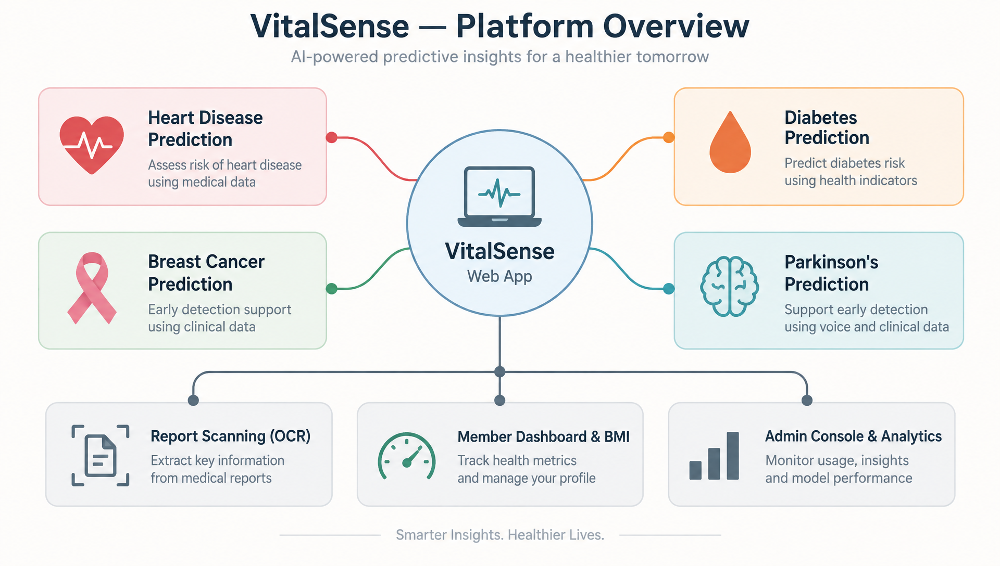

# VitalSense — Multi-Disease Prediction Platform

**Early insight for heart, metabolic, oncological and neurological risk.**

VitalSense is a web application that helps users estimate their risk for four major
conditions — **Heart Disease, Diabetes, Breast Cancer and Parkinson's Disease** — using
machine-learning models. Users can type in their clinical values or scan a printed
lab report with OCR to fill the forms automatically. A built-in administrator console
lets staff monitor platform usage and manage member accounts.



---

## Table of Contents

- [Features](#features)
- [Prediction Models](#prediction-models)
- [User Roles](#user-roles)
- [Project Structure](#project-structure)
- [Getting Started](#getting-started)
- [Backend Integration](#backend-integration)
- [Tech Stack](#tech-stack)
- [Disclaimer](#disclaimer)

---

## Features

### 🏠 Public Website
- Landing page introducing the four screening modules, with animated hero imagery.
- "How It Works" page explaining the prediction pipeline step by step.
- About page with organisation details and location (USJP, Faculty of Technology, Homagama).
- Legal pages: Terms & Conditions (including medical-data consent), Privacy Policy and Cookie Policy.

### 👤 Member Accounts
- **Registration** with personal details (full name, date of birth, gender, email,
  10-digit contact number), medical basics (height, weight, blood group) and account
  credentials.
- **Strong password policy** — minimum 8 characters with at least one letter, one
  number and one special character, with show/hide (eye) toggles on password fields.
- **Input validation everywhere** — no negative numbers, sensible ranges (e.g. height
  50–250 cm, weight 10–300 kg), and a smooth day/month/year dropdown date picker.
- **One account per person** — once registered, the register option is replaced by
  login; logged-in users never see login/register links again until they log out.
- **Forgot-password flow** — username verification → code entry → new password.
- **Personal dashboard** — profile summary, automatic BMI calculation with category,
  and the option to permanently delete the account.

### 🩺 Disease Prediction Modules
Each disease has a dedicated page with educational content, warning signs, a validated
input form and an instant risk result with a plain-language explanation and score gauge.

- Profile data (age, sex, BMI) is **pre-filled automatically** for logged-in members.
- Complex terms carry plain-language hints so non-medical users understand every field.
- Results are colour-coded (low / moderate / elevated risk) with tailored advice.

### 📄 Report Scanning (OCR)
- Available on the **Heart Disease** and **Diabetes** pages.
- Upload a photo or scan of a lab report; the OCR pipeline extracts values such as
  cholesterol, blood pressure, glucose and insulin and fills the form automatically.
- Users are always prompted to double-check extracted numbers against the printed report.

### 🛡️ Administrator Console
- Separate **admin login** (username + password), reachable from the home page and footer.
- Admin sessions are fully separated from member sessions — no member can access admin pages.
- **Dashboard with charts**: daily usage trends, activity per screening type, risk-level
  split and per-member activity.
- **Member management**: searchable table of all accounts, suspicious/fake-account
  detection flags, and one-click account removal.
- **Activity log**: every registration, login, report scan and prediction is recorded
  with timestamp, user and risk score; the log can be filtered, exported to CSV or cleared.

---

## Prediction Models

| Module | Key Inputs | Model |
| --- | --- | --- |
| **Heart Disease** | Age, sex, chest pain type, resting blood pressure, serum cholesterol, fasting blood sugar, resting ECG, max heart rate, exercise-induced angina, ST depression, ST slope, major vessels, thalassemia | Gradient boosting |
| **Diabetes** | Age, pregnancies, glucose, blood pressure, skin thickness, insulin, BMI, diabetes pedigree function, family history, activity level | Random forest |
| **Breast Cancer** | Mean radius, texture, perimeter, area, smoothness, compactness, concavity and concave points of cell nuclei | Support vector classifier |
| **Parkinson's Disease** | 22 sustained-vowel acoustic features (fundamental frequency, jitter, shimmer, NHR/HNR, RPDE, DFA, spread1/spread2, D2, PPE) plus motor symptom screening | XGBoost |

All inputs are range-validated in the UI before a prediction is produced.

---

## User Roles

| Capability | Guest | Member | Admin |
| --- | :-: | :-: | :-: |
| Browse site, read about conditions | ✅ | ✅ | ✅ |
| Run predictions | ❌ | ✅ | ✅ |
| Scan reports with OCR | ❌ | ✅ | ✅ |
| Personal dashboard & BMI | ❌ | ✅ | — |
| Usage analytics & charts | ❌ | ❌ | ✅ |
| Manage / remove member accounts | ❌ | ❌ | ✅ |
| View & export activity log | ❌ | ❌ | ✅ |

---

## Project Structure

```text
src/
├── assets/               # Imagery for hero and disease pages
├── components/           # Shared UI (header, footer, forms, OCR upload, results…)
│   └── ui/               # Reusable design-system primitives
├── lib/
│   ├── api.ts            # Central registry of backend API endpoints
│   ├── auth.tsx          # Member & admin authentication context
│   ├── activity.ts       # Activity/event logging
│   ├── prediction.ts     # Field definitions, ranges and scoring logic
│   └── site.ts           # Site metadata and disease definitions
├── routes/               # File-based routes (home, 4 disease pages, auth,
│                         # dashboard, admin console, legal pages…)
└── styles.css            # Design tokens, animations and theme
docs/
└── API_SPECIFICATION.md  # Full backend endpoint specification
```

---

## Getting Started

### Prerequisites
- Node.js 18+ (or Bun)

### Install & run

```sh
npm install        # or: bun install
npm run dev        # starts the dev server
```

Then open the printed local URL in your browser.

### Build for production

```sh
npm run build
```

---

## Backend Integration

The front end currently runs its models in the browser as a prototype. Every action
that requires a server is already catalogued:

- **`src/lib/api.ts`** — typed registry of all endpoint paths (auth, users, OCR,
  predictions, activity, admin, content, contact, health).
- **`docs/API_SPECIFICATION.md`** — complete request/response specification for the
  backend team, including DTOs for all four prediction models, validation rules,
  admin endpoints and error codes.

To point the app at a live backend, set the base URL:

```sh
VITE_API_BASE_URL=https://your-api.example.com
```

---

## Tech Stack

- **React 19** with **TypeScript**
- **TanStack Start / Router** — file-based routing, SSR-ready
- **Tailwind CSS v4** — token-based theming
- **Recharts** — admin analytics charts
- **shadcn-style UI primitives** and **Lucide** icons

---

## Disclaimer

VitalSense is a screening and educational tool. Its predictions are **not a medical
diagnosis** and must never replace consultation with a qualified healthcare
professional. Always discuss your results and symptoms with a doctor.
